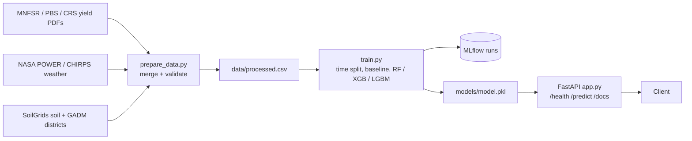

# District-Level Crop Yield Prediction for Pakistan Under Climate-Driven Data Drift

## Pitch
Crop yield models for Pakistan are trained once and assume the future climate resembles the past. Floods and heatwaves (2010, 2022) break that assumption, so static models degrade exactly when accuracy matters most. We build an MLOps system that predicts district-level yield (t/ha) for wheat, cotton, rice and sugarcane, and (in M2) retrains itself when climate-driven drift is detected.

## Architecture



## Quick start (Windows)

```
python -m venv venv
venv\Scripts\activate
pip install -r requirements.txt
python src/prepare_data.py
python -m src.train
mlflow ui                      # http://127.0.0.1:5000
uvicorn src.app:app --reload   # http://127.0.0.1:8000/docs
pytest tests/ -v
ruff check src/ tests/
```

`prepare_data.py` reads `data/raw/master.csv` if present; otherwise it generates a synthetic placeholder with the same schema.

## Data
One row per district x year x crop. Target: `yield_t_ha` = production / area.
Split: train <= 2017, validate 2018-2020, test 2021-2023 (test reserved for the M2 drift experiment).

## MLflow best run
<!-- Fill in after running on the real dataset. Values come from models/best_run.json. -->

| | Value |
|---|---|
| Run ID | `TODO` |
| Model | TODO |
| Hyperparameters | TODO |
| Validation RMSE | TODO |
| Last-year baseline RMSE | TODO |

**Why this run:** TODO (lowest validation RMSE; compare to baseline; note MAE/R2).

## Repository layout
```
src/prepare_data.py   data prep + validation
src/train.py          training + MLflow logging
src/app.py            FastAPI service
tests/test_app.py     unit tests
```

## Team
See [CONTRIBUTION.md](CONTRIBUTION.md).
